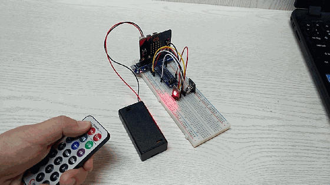
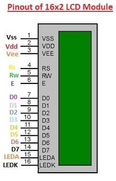
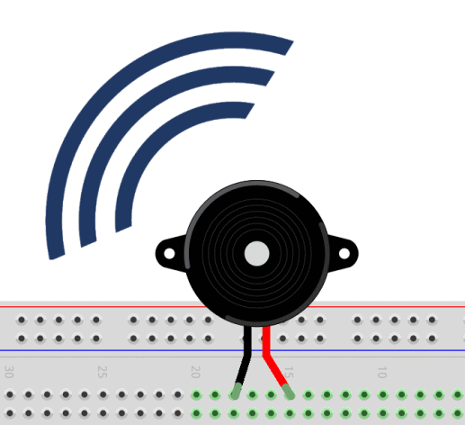

# Smart-Lab-Guardian

## 🔷 System Block Diagram

The Smart Lab Guardian system is designed using the LPC2148 microcontroller as its central processing unit. It receives inputs from multiple devices, processes them, and controls the output devices according to the programmed conditions.

### 🔹 Input Units
- **Keypad:** Used to provide user input and control system operations.
- **Emergency Switch:** Allows the user to trigger an emergency condition.
- **RTC Edit Switch:** Used to enter RTC date and time editing mode.
- **IR Receiver:** Receives signals from an IR remote for wireless control.

### 🔹 Processing Unit
- **LPC2148 Microcontroller:** Acts as the central controller, processes input signals, handles RTC operations, and manages the connected output devices.

### 🔹 Output Units
- **16×2 LCD Display:** Displays system status, date, time, and alert messages.
- **Device 1 (LED1):** Indicates the status of the first controlled device.
- **Device 2 (LED2):** Indicates the status of the second controlled device.
- **Buzzer:** Provides audible alerts during emergency conditions.

### ⚙️ Working Principle
The input devices send signals to the LPC2148 microcontroller. Based on the received inputs and programmed logic, the microcontroller processes the information and controls the LCD, LEDs, and buzzer accordingly. The RTC provides time-related information for system operations.

|===========================================================================|
|===========================================================================|

## ⏰ Real-Time Clock (RTC) Module

The RTC module is used to maintain accurate date and time information in the Smart Lab Guardian system. It helps the microcontroller track real-time information and supports time-based system operations.

### 🔹 Features
- Maintains current time, date, month, and year.
- Provides real-time clock information to the microcontroller.
- Supports date and time editing through the RTC Edit Switch.
- Helps display current date and time on the 16×2 LCD.
- Maintains timekeeping independently when supported by a backup battery.

### ⚙️ Working Principle
The RTC module continuously maintains time and date information. The LPC2148 microcontroller reads this information and displays it on the LCD. When the RTC Edit Switch is activated, the system enters RTC editing mode, allowing the user to modify the time and date.

**Interface:** LPC2148 Microcontroller

|================================================================================================================|
|================================================================================================================|

## 📡 IR Receiver Module

The IR Receiver module is used to receive wireless commands from an IR remote control in the Smart Lab Guardian system. It allows the user to control system operations remotely without requiring direct physical interaction.

### 🔹 Features
- Receives infrared signals from the remote control.
- Enables wireless control of connected devices.
- Provides remote input commands to the LPC2148 microcontroller.
- Reduces the need for manual switch operations.
- Supports convenient and user-friendly system control.

### ⚙️ Working Principle
When a button is pressed on the IR remote, it transmits an infrared signal. The IR Receiver detects this signal and sends the corresponding data to the LPC2148 microcontroller. The microcontroller decodes the received command and performs the assigned operation, such as controlling Device 1 or Device 2.

**Interface:** LPC2148 Microcontroller

**Communication:** Infrared (IR) Signal

|================================================================================================================|
|================================================================================================================|

## 📟 16×2 Alphanumeric LCD Display

The 16×2 Alphanumeric LCD is used as the primary visual output unit in the Smart Lab Guardian system. It provides real-time information about system operations, user inputs, and emergency conditions.

### 🔹 Features
- Displays system status and notifications.
- Shows current date and time received from the RTC module.
- Displays emergency warning messages.
- Provides feedback during RTC editing mode.
- Displays information related to device operations.
- Supports clear and user-friendly interaction.

### ⚙️ Working Principle
The LPC2148 microcontroller sends commands and data to the LCD to display the required information. Based on inputs received from the keypad, emergency switch, RTC edit switch, and IR receiver, the microcontroller updates the LCD with appropriate messages and system status.

**Interface:** LPC2148 Microcontroller

**Display:** 16 Characters × 2 Lines

**Communication:** 4-bit / 8-bit mode (based on circuit configuration)

|================================================================================================================|
|================================================================================================================|

## 🔢 4×4 Matrix Keypad (KPM)

The 4×4 Matrix Keypad is used as a user input interface in the Smart Lab Guardian system. It allows users to enter commands and interact with the system through its 16 keys.

### 🔹 Features
- Consists of 4 rows and 4 columns (16 keys).
- Allows users to enter numeric and control inputs.
- Supports user interaction with system functions.
- Can be used for selecting different operations.
- Reduces the need for multiple individual push buttons.

### ⚙️ Working Principle
The keypad is interfaced with the LPC2148 microcontroller. When a key is pressed, the microcontroller scans the rows and columns to identify the pressed key. The detected key is processed according to the programmed logic to perform the corresponding operation in the Smart Lab Guardian system.

**Interface:** LPC2148 Microcontroller

**Key Configuration:** 4 Rows × 4 Columns

**Total Keys:** 16

|================================================================================================================|
|================================================================================================================|

## 💡 Dual LED Indicator System

Two LEDs are used as visual indicators in the Smart Lab Guardian system. They provide visual feedback about the operating status and different system conditions.

### 🔹 Features
- Uses two LEDs for visual indication.
- Provides individual control of both LEDs.
- Indicates different system operating conditions.
- Controlled independently through the LPC2148 GPIO pins.
- Provides quick visual feedback to the user.

### ⚙️ Working Principle
The two LEDs are connected to the GPIO pins of the LPC2148 microcontroller through current-limiting resistors. Based on the programmed conditions and received inputs, the microcontroller controls each LED independently by switching it ON or OFF.

**Interface:** LPC2148 Microcontroller

**Output Devices:** 2 LEDs

**Control:** GPIO Digital Output

|================================================================================================================|
|================================================================================================================|

## 🔔 Buzzer Alert System

The buzzer is used as an audio alert unit in the Smart Lab Guardian system. It provides audible warnings to notify users about emergency conditions and important system events.

### 🔹 Features
- Generates audible alert signals.
- Provides emergency notifications.
- Indicates important system conditions through sound.
- Controlled by the LPC2148 microcontroller.
- Supports timed beep operations.

### ⚙️ Working Principle
The buzzer is connected to a GPIO output pin of the LPC2148 microcontroller. When an emergency condition or a programmed alert event occurs, the microcontroller activates the buzzer. The buzzer produces an audible warning for the specified duration and switches OFF when the alert period is completed.

**Interface:** LPC2148 Microcontroller

**Output Device:** Buzzer

**Control:** GPIO Digital Output

|================================================================================================================|
|================================================================================================================|

## 🔘 Dual Push Button Interface Using External Interrupts

Two push buttons are interfaced with the LPC2148 microcontroller using external interrupt pins. This allows the system to respond immediately to button presses without continuously polling the input pins.

### 🔹 Features
- Uses two push buttons as external interrupt inputs.
- Provides interrupt-based input handling.
- Avoids continuous polling of push buttons.
- Enables quick response to user actions.
- Supports independent interrupt operations.

### ⚙️ Working Principle
The two push buttons are connected to the external interrupt pins of the LPC2148 microcontroller. When a button is pressed, it generates an external interrupt request. The microcontroller executes the corresponding Interrupt Service Routine (ISR) and sets the appropriate software flag.

- **Push Button 1 – RTC Edit:** Generates an external interrupt to activate RTC editing mode.
- **Push Button 2 – Emergency:** Generates an external interrupt to trigger the emergency condition.

The main program checks the respective flags and performs the required operations.

### 🔧 Interrupt Configuration
- **Controller:** LPC2148
- **Input Devices:** 2 Push Buttons
- **Mechanism:** External Hardware Interrupts
- **Processing:** Interrupt Service Routines (ISR)
- **Communication:** GPIO / External Interrupt Interface

